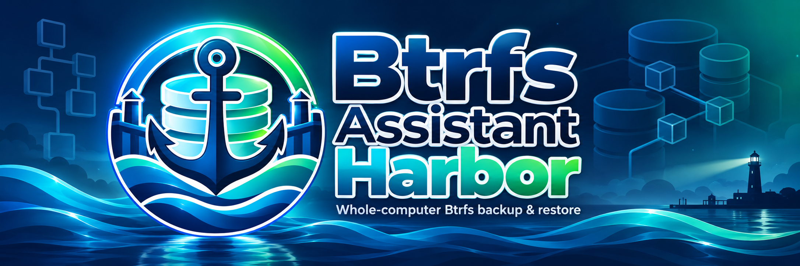
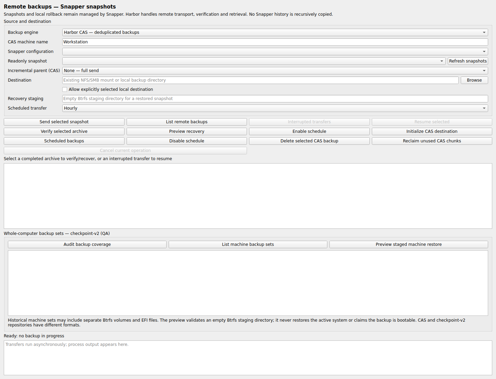

<h1 align="center">⚓ Btrfs Assistant Harbor</h1>

<strong>Snapshots in. Systems back.</strong> 
<strong>Vos snapshots méritent un endroit plus sûr.</strong> Sauvegardez votre poste Linux, vérifiez chaque transfert et préparez votre restauration — dans l'interface Btrfs Assistant que vous connaissez déjà.

  <a href="https://github.com/GodsQuantum/BTRFS-Assistant-Harbor/releases/latest"><strong>📦 Télécharger pour Linux</strong></a> ·
  <a href="docs/WORKSTATION_BACKUPS.fr.md">📖 Démarrer</a> ·
  <a href="docs/TECHNICAL.fr.md">⚙️ Comprendre</a>

  <a href="README.md">English</a> · <a href="README.fr.md">Français</a> · <a href="README.zh-CN.md">简体中文</a>

  
  
  
  

---

**Un snapshot local ne remplace pas une sauvegarde sur un autre disque.** Harbor réunit les deux.

## ✨ Ce que ça change

- **🛟 Snapshots protégés.** Envoyez-les vers un NAS et vérifiez leur intégrité.
- **🧩 Un seul foyer pour vos sauvegardes.** La déduplication partage les données identiques entre postes **Linux**, sans confondre les archives de chacun.
- **♻️ Restauration maîtrisée.** Vérifiez et récupérez dans un dossier Btrfs vide.
- **🖥️ Btrfs Assistant, en mieux.** Snapper et sauvegardes distantes dans une application Qt native.

## 📸 L'application en images

<em>Capture réelle de l'onglet Qt 6, dans un environnement de test hors ligne, sans fausses sauvegardes.</em>

**🌍 Langue de l’interface :** sélectionnez **English**, **Français** ou **简体中文** dans la barre supérieure. Fermez puis rouvrez Harbor pour appliquer la langue à tous les écrans, même avec les droits administrateur.

## 🚀 Trois étapes pour commencer

1. **Téléchargez** le paquet Arch/CachyOS, Debian 13 ou Fedora 44 depuis les [Releases](https://github.com/GodsQuantum/BTRFS-Assistant-Harbor/releases/latest), puis vérifiez `SHA256SUMS`.
2. **Ouvrez Harbor → Sauvegardes distantes.** Choisissez un snapshot Snapper en lecture seule et une destination existante correctement montée.
3. **Envoyez → Vérifiez.** Contrôlez l'archive et effectuez une restauration de test en zone de préparation.

Harbor coexiste avec Btrfs Assistant : **aucun compte cloud, Docker ou changement Snapper imposé**.

**Plusieurs postes sur un même NAS ?** Utilisez la même racine CAS déjà présente pour vos postes **Linux** : le pool de données est commun, mais les archives restent séparées par machine. [Guide complet →](docs/WORKSTATION_BACKUPS.fr.md)

## 🧭 Les limites, sans surprise

Harbor vise **Linux x86-64 / Btrfs / Snapper**. L'écriture et la vérification sur NAS sont possibles, mais le nettoyage CAS **destructif sur NFS/SMB est volontairement bloqué**. macOS/APFS n'est pas encore pris en charge ; la récupération intégrale d'un système chiffré/multi-racines n'est pas promise. [Compatibilité et certification →](docs/TECHNICAL.fr.md)

<strong>⚓ Sauvegarder le snapshot. Garder la liberté de restaurer.</strong>

[📖 Configuration & restauration](docs/WORKSTATION_BACKUPS.fr.md) · [⚙️ Détails techniques](docs/TECHNICAL.fr.md) · [🛡️ Sécurité](SECURITY.md) · [🤝 Contribuer](CONTRIBUTING.md) · [🎨 Branding](branding/PRESSKIT.md)

Fork indépendant de <a href="https://gitlab.com/btrfs-assistant/btrfs-assistant">Btrfs Assistant</a>, sous GPL-3.0-or-later, sans affiliation ni validation par l'équipe d'origine.
