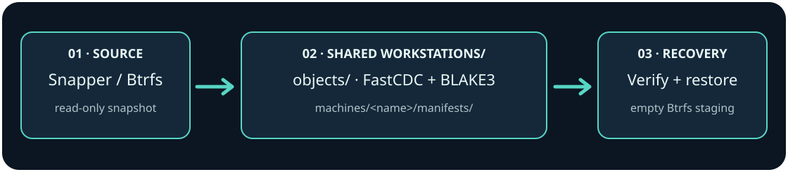

# ⚓ Technical setup and recovery

[← Home](../README.md) · [Technical details](TECHNICAL.md)

## 🛟 Your local snapshots deserve an off-device backup

A Snapper snapshot helps roll back a change — but **a snapshot on the same disk is not a backup**. Harbor builds on the familiar [Btrfs Assistant](https://gitlab.com/btrfs-assistant/btrfs-assistant) interface and adds tools to transfer read-only Btrfs snapshots, verify stored data and stage a restore without overwriting your live root filesystem.

| | What you can do |
|---|---|
| 🧭 **Keep Btrfs Assistant** | Manage Snapper snapshots, Btrfs subvolumes and local rollback in the native Qt 6 interface. |
| 📦 **Back up off-device** | Send full and incremental Btrfs snapshots with verification. A dedicated NFS-backed folder is suitable for storage; validate the mount before writing. |
| 🧩 **Share a CAS repository** | Keep one `Workstations/` repository and one chunk pool; separate archives by machine under `machines/<name>/manifests/`. |
| ♻️ **Resume and retain safely** | Inspect interrupted transfers, verify archives and preview retention decisions. Destructive CAS garbage collection on NFS/SMB is intentionally blocked. |
| 🔎 **Rehearse recovery** | Restore into a new empty Btrfs staging destination, verify it, and choose next steps yourself. Live-root overwrite is never automatic. |
| 🌍 **Three languages** | English, français and 简体中文, plus upstream translations. |

<p align="center"></p>

## 📥 Install

Download the verified **Linux x86-64** package for your distribution from [GitHub Releases](https://github.com/GodsQuantum/BTRFS-Assistant-Harbor/releases/latest). Current release families: **Arch/CachyOS** (`.pkg.tar.zst`), **Debian 13** (`.deb`) and **Fedora 44** (`.rpm`). Confirm the `SHA256SUMS` file before installation.

On Arch/CachyOS, from the directory containing the downloaded assets:

```bash
sha256sum -c SHA256SUMS
sudo pacman -U ./btrfs-assistant-harbor-*-x86_64.pkg.tar.zst
```

Launch **Btrfs Assistant Harbor** from the KDE application menu. It installs alongside upstream Btrfs Assistant; it does not delete that package or rewrite Snapper configurations.

## 🚀 First workstation backup

1. Open the **Remote backups** tab and select a Snapper configuration and an existing **read-only** snapshot.
2. Select the **Harbor CAS** engine. Use a **dedicated NFS-mounted backup directory**, never an unmounted lookalike local folder.
3. Use **Initialize CAS destination** once, at your shared `Workstations/` root. Harbor creates `.harbor-repo-id`, `objects/`, and per-machine `machines/<hostname>/manifests/`. The machine name can be edited.
4. **Send selected snapshot**, then **List remote backups** and **Verify selected archive**. Reuse the same repository for other Linux workstations without making a separate object pool.
5. Test restoration into a new empty **Btrfs staging** directory. Keep an independent backup until you have validated recovery for your own machine.

**Important:** a network mount is not the same as a local disk. The CAS engine refuses destructive garbage collection on NFS/SMB/SSHFS/9p because distributed locking has not been certified. Preserve that safety guard. The legacy **checkpoint-v2** archive format is separate from CAS.

## ✅ Verified, with explicit boundaries

The [Linux 0.1.0 certification](validation/QA_LINUX_STABLE_SCOPE_2026-10-22.md) covers Rust tests/Clippy, Qt/Python, real Snapper on Btrfs, two Linux QEMU backup/restore guests, cancellation of a real `btrfs send`, multi-client CAS checks, 1,000 cycles and native package lifecycle in CI. Each new release must pass its own checks.

**Not supported:** native macOS/APFS backup; destructive CAS cleanup on network filesystems; Secure Boot, LUKS/RAID/LVM or multi-root bare-metal ReaR recovery. The optional ReaR path has been validated only for a single-root UEFI/GRUB Btrfs topology with a FAT32 ESP and Secure Boot off. Physical power-loss and every hardware/desktop combination have not been certified.

## 🧰 Build and contribute

Requirements: CMake, Ninja, C++17, Qt 6 Widgets/Test/LinguistTools, libbtrfsutil, btrfs-progs, Rust/Cargo and Python 3.

```bash
git clone https://github.com/GodsQuantum/BTRFS-Assistant-Harbor.git
cd BTRFS-Assistant-Harbor
cmake -S . -B build -G Ninja -DCMAKE_BUILD_TYPE=Release -DCMAKE_INSTALL_PREFIX=/usr
cmake --build build --parallel 4
QT_QPA_PLATFORM=offscreen ctest --test-dir build --output-on-failure
cargo test --locked --manifest-path transport/Cargo.toml --all-targets
```

Read [contributing guidelines](../CONTRIBUTING.md), [security policy](../SECURITY.md), [branding](../branding/BRAND.md) and the [tested recovery scope](validation/QA_LINUX_STABLE_SCOPE_2026-10-22.md). Bug reports and reproducible failure cases: [Issues](https://github.com/GodsQuantum/BTRFS-Assistant-Harbor/issues).

**Credits & license.** This is an independent fork of **Btrfs Assistant** (GPL-3.0-or-later), not an upstream-endorsed product. The bundled legacy Harbor/Python component has its own MIT notices. See [LICENSE](../LICENSE) and its included third-party licenses.
